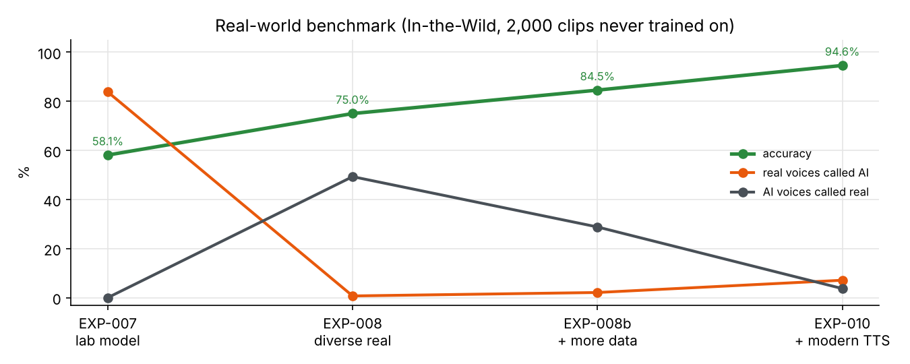
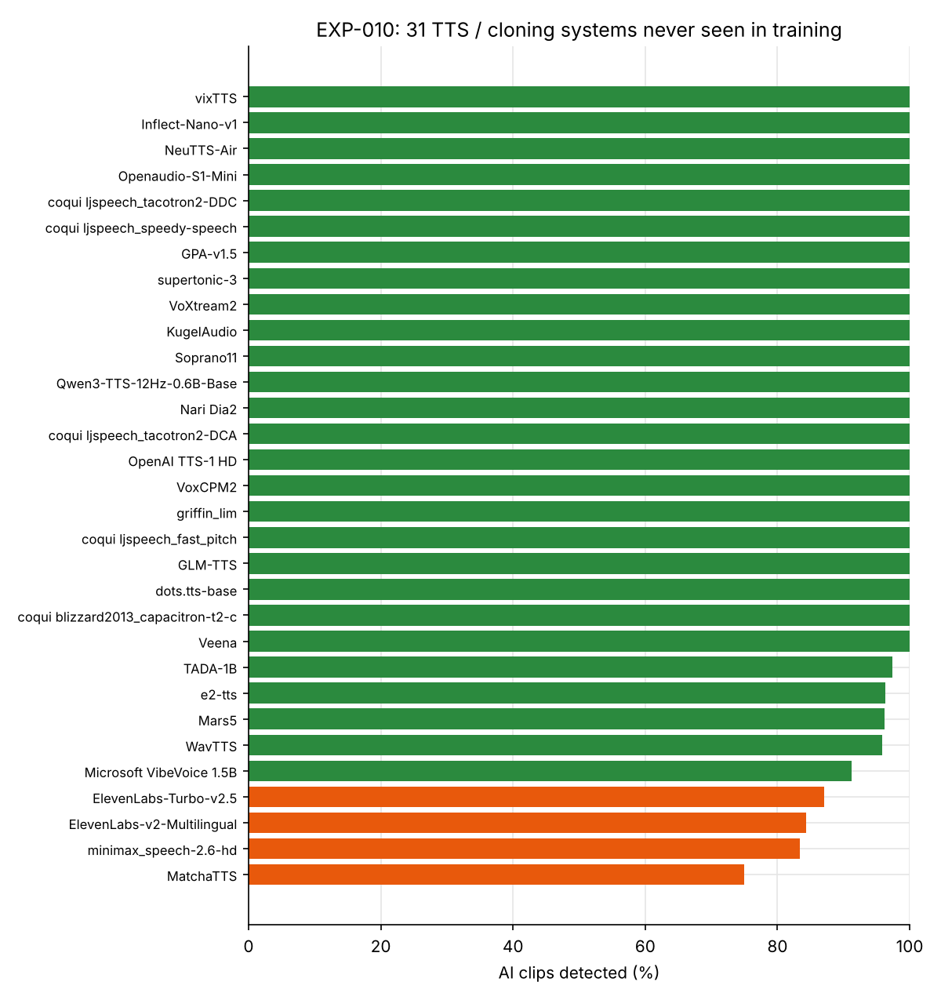

# CompressedAudioForensics

**Detecting AI-cloned voices in compressed, real-world audio (WhatsApp, Telegram, phone calls).**

## Why this project exists
Online voice scams are growing fast. With a few seconds of someone's voice, free AI tools can clone it, and
fraudsters use these clones to call or send voice notes pretending to be a family member, a boss, a bank officer
or the police, usually asking for money urgently. Human judgement fails against modern clones, and most AI
detectors are trained on clean studio audio, while real scam audio arrives heavily compressed by messaging apps.
This project builds a detector for the audio people *actually* receive: one compressed file, no original to compare.

## Result
The final model (**EXP-010**) reaches **94.6% accuracy on 2,000 real-world clips it never saw**, catches
**98.5% of voices from 31 AI voice tools it was never trained on** (ElevenLabs, OpenAI, MiniMax, Qwen …), and
passed a live test with real and AI voices shared over WhatsApp.



| Test (never trained on) | Accuracy | Real voice called AI | AI voice called real | EER |
|---|---|---|---|---|
| In-the-Wild: 2,000 clips of 58 public figures from online videos | **94.6%** | 7.1% | 3.7% | 5.1% |
| MLAAD: 31 held-out TTS / voice-cloning systems | **98.5%** | 0.1% | 3.0% | 1.2% |
| ASVspoof 2019 LA (unseen attacks), clean / MP3 16 kbps | 97.9 / 97.0% | 0.4 / 1.2% | 3.8 / 4.8% | 1.8 / 2.8% |

## The final model (EXP-010)
```
any audio file ─► FFmpeg decode (16 kHz mono) ─► 4 s windows, 50% overlap
   └─► WavLM-Base+ (CNN + 12 transformer layers, top 8 fine-tuned)
         ├─ main branch:    learned weights over all 13 layers ─► attentive stats pooling ─► MLP ─┐
         └─ texture branch: learned weights over layers 0–6    ─► attentive stats pooling ─► MLP ─┴─► summed score
   ─► median over speech windows ─► Platt calibration ─► verdict + timeline + 6 diagnostic images
```
- **Training data (39,472 clips, balanced real/AI inside every source):** ASVspoof 5 (crowdsourced speakers),
  Fake-or-Real, LibriSeVoc (6 neural vocoders), ASVspoof 2019 LA, and **MLAAD** (143 modern TTS / cloning systems).
- **Compression robustness:** every clip also has a copy encoded with MP3 / Opus / AAC at 8–64 kbps, so the model
  learns the voice, not the codec.
- **Texture branch:** diagnostics showed the earlier model judged only by how *natural* the speech sounded (top
  WavLM layer). The second branch looks only at the low "sound texture" layers, where synthesis artefacts live.
- **Honest testing:** 31 TTS systems kept out of training entirely; In-the-Wild and ASVspoof 2019 eval never trained on.



## How we got here
Full write-ups in [`EXPERIMENT_LOG.md`](EXPERIMENT_LOG.md); graphs for every experiment in [`mapped_results/`](mapped_results/).

**Ideas that failed**
- **EXP-001/002 · Δ-Net (original hypothesis).** Re-degrade the received file (μ-law) and measure how the voice
  representation shifts. Pre-registered pilot: the shift (AUC 0.91–0.95) was *weaker* than the plain embedding
  (0.97–0.98) and partly a loudness cue. Rejected and kept as a documented negative result.
- **EXP-009a/b · Spectrogram "fingerprint" images + CNN.** Mel, fine-spectrum and phase pictures with ResNet-18:
  91–93% vs 98–99% for WavLM. Phase information does not survive compression (stability 0.08); keeping only
  compression-stable features dropped the CNN to 85–87%, and fusing it with WavLM was significantly worse in all
  9 conditions (McNemar p < 0.001). Image route closed.

**Lab successes that failed in real life**
- **EXP-003 → 006 · Frozen WavLM + bitrate-aware calibration (method F).** The official RawNet2 baseline lost
  15 points of accuracy at 8 kbps. A frozen WavLM front end with a linear probe reached EER 1–2% at every bitrate;
  per-bitrate calibration chosen from the app's "source app" dropdown and RawBoost augmentation gave
  **98–99% down to 16 kbps and 95% at 8 kbps**, including Opus (WhatsApp) and AAC it never saw, robust to
  re-compression (forwarded voice notes). Built into a web app.
- **EXP-007 · Reality check.** A live recording of a real voice was called AI. On In-the-Wild, method F called
  **83.8% of real voices AI**. Cause: all "real" training speech came from one studio corpus (VCTK), so any other
  microphone or room looked "not real". Lesson: lab accuracy on one corpus says nothing about real life.
- **EXP-008/008b · Fine-tuning on diverse real speech.** Partially fine-tuned WavLM on ASVspoof 5, Fake-or-Real,
  LibriSeVoc and ASVspoof 2019, balanced inside every dataset. False alarms fell 83.8% → 2.1% and accuracy rose to
  84.5%, and the live test on a real voice passed. But **every clip from a modern online voice-cloning tool scored
  "100% human"**. New per-file diagnostics (removing frequency bands / WavLM layers and measuring the score change)
  showed why: the decision came almost only from WavLM's top layer, which judges naturalness, and the training
  fakes were all older-generation TTS.

**What we applied in EXP-010:** modern TTS fakes (MLAAD), a texture branch on the low layers, more fine-tuned layers,
held-out generators for honest testing, and live tests before claiming success.

## Web app
`run_app.bat` starts a local web app (FastAPI, nothing leaves the machine; uploads are deleted after analysis).
Upload a voice note, optionally pick the source app, and get a verdict, a per-window confidence timeline and six
diagnostic images (spectrogram, time × frequency map, frequency-band and WavLM-layer importance, attention,
acoustic profile). Results are probabilistic and are not legal evidence.

## Setup and run
```bash
# Windows: double-click setup.bat  (creates .venv, picks the right CUDA build, installs FFmpeg)
pip install torch torchaudio --index-url https://download.pytorch.org/whl/cu130
pip install -r requirements.txt
```
| Step | Command |
|---|---|
| Download datasets | `download_datasets.bat`, `download_mlaad.bat` (needs `HF_TOKEN`, MLAAD terms accepted) |
| Train + test the final model | `run_exp010.bat` |
| Web app | `run_app.bat` → http://127.0.0.1:7860 |
| Earlier experiments | `run_exp006.bat` … `run_exp009b.bat`, or `python experiments/<script>.py` |

Datasets and pretrained weights are **not** included; links and paths are listed in `requirements.txt`.

## Repository layout
```
src/models/     WavLM detector (main + texture branch), RawNet2, Δ-Net
src/app/        web app: server, diagnostics, single-page UI
src/data/       audio loading, FFmpeg codec simulation, manifests
src/evaluation/ EER / AUC / bootstrap CI, Platt calibration
experiments/    one script per experiment
mapped_results/ graphs per experiment (EXP-001 … EXP-010)
```

## Data & licences
ASVspoof 2019/5, Fake-or-Real, LibriSeVoc, In-the-Wild and MLAAD (CC BY-NC 4.0) are distributed by their authors
under their own licences and are not redistributed here. Research use only.
