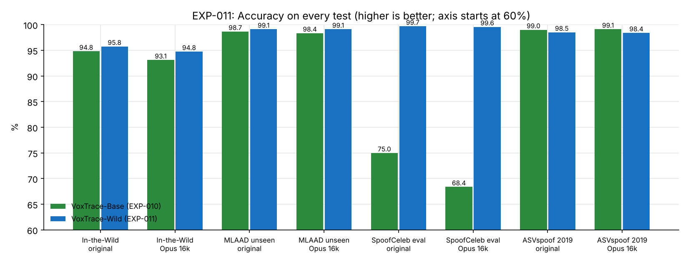

# CompressedAudioForensics

**Detecting AI-cloned voices in compressed, real-world audio (WhatsApp, Telegram, phone calls).**

## Why this project exists
Online voice scams are growing fast. With a few seconds of someone's voice, free AI tools can clone it, and
fraudsters use these clones to call or send voice notes pretending to be a family member, a boss, a bank officer
or the police, usually asking for money urgently. Human judgement fails against modern clones, and most AI
detectors are trained on clean studio audio, while real scam audio arrives heavily compressed by messaging apps.
This project builds a detector for the audio people *actually* receive: one compressed file, no original to compare.

## Result
Two detectors, selectable in the app, built on the same design:

| Model | Trained on | In-the-Wild (2,000 real-world clips) | 31 unseen AI voice tools | SpoofCeleb evaluation |
|---|---|---|---|---|
| **VoxTrace-Wild** (default, EXP-011) | 5 datasets + 120,000 in-the-wild celebrity clips (SpoofCeleb), 64/32/16/8 kbps | **95.8%** (EER 3.8%) | **99.1%** (EER 0.7%) | **99.7%** |
| **VoxTrace-Base** (EXP-010) | 5 datasets incl. 143 modern TTS / cloning systems (MLAAD) | 94.8% (EER 5.0%) | 98.7% (EER 1.3%) | 75.0% |

All test sets were never used for training. The 31 tools include ElevenLabs, OpenAI, MiniMax and Qwen. Both models
passed live tests with real and AI voices shared over WhatsApp.


| VoxTrace-Wild, test never trained on | Accuracy | Real voice called AI | AI voice called real | EER |
|---|---|---|---|---|
| In-the-Wild, original / WhatsApp-quality (Opus 16 kbps) | **95.8 / 94.8%** | 5.2 / 7.3% | 3.3 / 3.2% | 3.8 / 4.6% |
| MLAAD: 31 held-out TTS / voice-cloning systems | **99.1%** | 0.3% | 1.5% | 0.7% |
| SpoofCeleb evaluation (9 unseen attack systems) | **99.7%** | 0.2% | 0.5% | 0.2% |
| ASVspoof 2019 LA (unseen attacks), original / Opus 16 kbps | 98.5 / 98.4% | 0.4 / 1.6% | 2.6 / 1.6% | 1.8 / 1.6% |

## The model (VoxTrace)
```
any audio file ─► FFmpeg decode (16 kHz mono) ─► 4 s windows, 50% overlap
   └─► WavLM-Base+ (CNN + 12 transformer layers, top 8 fine-tuned)
         ├─ main branch:    learned weights over all 13 layers ─► attentive stats pooling ─► MLP ─┐
         └─ texture branch: learned weights over layers 0–6    ─► attentive stats pooling ─► MLP ─┴─► summed score
   ─► median over speech windows ─► Platt calibration ─► verdict + timeline + 6 diagnostic images
```
- **Texture branch:** diagnostics showed an earlier model judged only by how *natural* the speech sounded (top
  WavLM layer). The second branch looks only at the low "sound texture" layers, where synthesis artefacts live.
- **VoxTrace-Base (EXP-010):** 39,472 clips from ASVspoof 5, Fake-or-Real, LibriSeVoc, ASVspoof 2019 LA and
  **MLAAD** (143 modern TTS systems; 31 held out for testing), each with one random MP3/Opus/AAC copy at 8–64 kbps.
- **VoxTrace-Wild (EXP-011):** the same data + 120,000 **SpoofCeleb** clips (real celebrity speech from online
  videos and AI voices built from it), every clip trained original + 64k + 32k, 16k for 35% and 8k for 10%:
  **550,259 examples**, compressed on the fly. The extra in-the-wild real speech removed a hidden weakness of
  VoxTrace-Base (it flagged 46% of real interview-style voices) and improved every real-world test.
- **Honest testing:** whole TTS systems and attack systems held out; In-the-Wild and ASVspoof 2019 eval never trained on.




## How we got here
Full write-ups in [`EXPERIMENT_LOG.md`](EXPERIMENT_LOG.md); graphs for every experiment in [`mapped_results/`](mapped_results/).

**Ideas that failed**
- **EXP-001/002 · Δ-Net (original hypothesis).** Re-degrade the received file (μ-law) and measure how the voice
  representation shifts. Pre-registered pilot: the shift (AUC 0.91–0.95) was *weaker* than the plain embedding
  (0.97–0.98) and partly a loudness cue. Rejected and kept as a documented negative result.
- **EXP-009a/b · Spectrogram "fingerprint" images + CNN.** Mel, fine-spectrum and phase pictures with ResNet-18:
  91–93% vs 98–99% for WavLM. Phase information does not survive compression (stability 0.08); keeping only
  compression-stable features dropped the CNN to 85–87%, and fusing it with WavLM was significantly worse in all
  9 conditions (McNemar p < 0.001). Image route closed.

**Lab successes that failed in real life**
- **EXP-003 → 006 · Frozen WavLM + bitrate-aware calibration (method F).** The official RawNet2 baseline lost
  15 points of accuracy at 8 kbps. A frozen WavLM front end with a linear probe reached EER 1–2% at every bitrate;
  per-bitrate calibration chosen from the app's "source app" dropdown and RawBoost augmentation gave
  **98–99% down to 16 kbps and 95% at 8 kbps**, including Opus (WhatsApp) and AAC it never saw, robust to
  re-compression (forwarded voice notes). Built into a web app.
- **EXP-007 · Reality check.** A live recording of a real voice was called AI. On In-the-Wild, method F called
  **83.8% of real voices AI**. Cause: all "real" training speech came from one studio corpus (VCTK), so any other
  microphone or room looked "not real". Lesson: lab accuracy on one corpus says nothing about real life.
- **EXP-008/008b · Fine-tuning on diverse real speech.** Partially fine-tuned WavLM on ASVspoof 5, Fake-or-Real,
  LibriSeVoc and ASVspoof 2019, balanced inside every dataset. False alarms fell 83.8% → 2.1% and accuracy rose to
  84.5%, and the live test on a real voice passed. But **every clip from a modern online voice-cloning tool scored
  "100% human"**. New per-file diagnostics (removing frequency bands / WavLM layers and measuring the score change)
  showed why: the decision came almost only from WavLM's top layer, which judges naturalness, and the training
  fakes were all older-generation TTS.

**What worked**
- **EXP-010 · VoxTrace-Base.** Modern TTS fakes (MLAAD), a texture branch on the low layers and more fine-tuned
  layers: In-the-Wild 84.5% → 94.6%, 98.5% on 31 unseen TTS systems, and the first model to pass the live test.
- **EXP-010b · Standby for re-compressed audio (not deployed).** A copy of EXP-010 topped up on audio compressed
  twice: fewer false alarms on forwarded audio, but more missed fakes and a lower lab score, so it was kept aside.
- **EXP-011 · VoxTrace-Wild.** Tested EXP-010 on SpoofCeleb: it caught 98.8% of the fakes but flagged 46% of the
  real celebrity voices. Retraining the same design on EXP-010's data + 120,000 SpoofCeleb clips with a stronger
  compression schedule fixed that (0.2%) and improved In-the-Wild (EER 5.0 → 3.8%) and unseen-TTS results.

## Web app
`run_app.bat` starts a local web app (FastAPI, nothing leaves the machine; uploads are deleted after analysis).
Upload a voice note, choose VoxTrace-Wild or VoxTrace-Base, optionally pick the source app, and get a verdict, a per-window confidence timeline and six
diagnostic images (spectrogram, time × frequency map, frequency-band and WavLM-layer importance, attention,
acoustic profile), computed in memory and never stored. Results are probabilistic and are not legal evidence.

## Download the models
Trained weights are published in release **[v1.0 – VoxTrace models](https://github.com/sirikumar9106/CompressedAudioForensics/releases/tag/v1.0)**:

| Model | File | Size |
|---|---|---|
| **VoxTrace-Wild** (default) | [exp010_sc_wavlm_ft.pt](https://github.com/sirikumar9106/CompressedAudioForensics/releases/download/v1.0/exp010_sc_wavlm_ft.pt) | 381 MB |
| **VoxTrace-Base** | [exp010_wavlm_ft.pt](https://github.com/sirikumar9106/CompressedAudioForensics/releases/download/v1.0/exp010_wavlm_ft.pt) | 381 MB |

Put both files in the `models/` folder and run `run_app.bat`; the app loads whichever models it finds.

## Setup and run
```bash
# Windows: double-click setup.bat  (creates .venv, picks the right CUDA build, installs FFmpeg)
pip install torch torchaudio --index-url https://download.pytorch.org/whl/cu130
pip install -r requirements.txt
```
| Step | Command |
|---|---|
| Download datasets | `tools/download_datasets.bat`, `tools/download_mlaad.bat`; SpoofCeleb is fetched by `train_voxtrace_wild.bat` (needs `HF_TOKEN`; MLAAD and SpoofCeleb terms accepted) |
| Train + test the models | `train_voxtrace_base.bat` (VoxTrace-Base), `train_voxtrace_wild.bat` (SpoofCeleb download + VoxTrace-Wild) |
| Web app | `run_app.bat` → http://127.0.0.1:7860 |
| Earlier experiments | launchers in `archived_experiments/`, or `python experiments/<script>.py` |

Datasets are **not** included; links and paths are listed in `requirements.txt`. Trained models: see *Download the models* above.

## Repository layout
```
src/models/     VoxTrace detector (WavLM + main and texture branch), RawNet2, Δ-Net
src/app/        web app: server, diagnostics, single-page UI
src/data/       audio loading, FFmpeg codec simulation, manifests
src/evaluation/ EER / AUC / bootstrap CI, Platt calibration
experiments/    one script per experiment
archived_experiments/  launchers for earlier experiments (EXP-006 … EXP-011 test runs)
tools/          setup, dataset download and cleanup scripts
mapped_results/ graphs per experiment (EXP-001 … EXP-011)
```

## Data & licences
ASVspoof 2019/5, Fake-or-Real, LibriSeVoc, In-the-Wild, MLAAD (CC BY-NC 4.0) and SpoofCeleb (CC BY 4.0) are distributed by their authors
under their own licences and are not redistributed here. Research use only.
